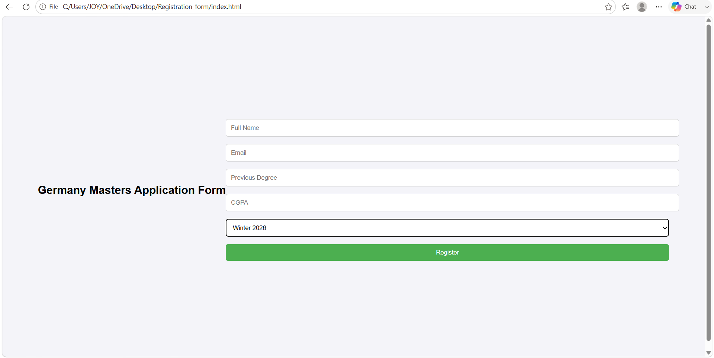

# Student Registration Form

A simple student registration form for a Germany master’s application, built using HTML, CSS, and JavaScript.

The project demonstrates form creation, basic browser validation, styling, and JavaScript event handling.

## Features

- Fields for full name, email address, previous degree, and CGPA.
- Intake selection: Winter 2026 or Summer 2027.
- Required fields for name, email, and previous degree.
- Browser-based email format validation.
- Styled input fields and a Register button with a hover effect.

## Technologies Used

| Technology | Purpose |
|---|---|
| HTML5 | Form structure and input fields |
| CSS3 | Page styling and button effects |
| JavaScript | Handling the form submission event |

## Project Files

| File | Description |
|---|---|
| `index.html` | Registration form and application fields |
| `style.css` | Page and form styling |
| `script.js` | Form submission event handler |
| `Screenshot_of_registrationForm.png` | Screenshot of the registration form |
| `README.md` | Project documentation |

## Getting Started

1. Clone the repository:

```bash
git clone https://github.com/JerushaJutike29/Student-Registration-Form.git
cd Student-Registration-Form
```

2. Open `index.html` in a web browser.

No package installation, build process, or backend server is required.

## How It Works

1. Enter the student’s name, email address, and previous degree.
2. Optionally enter a CGPA.
3. Select an intake.
4. Click **Register**.

The browser checks the required fields and email format. JavaScript intercepts submission to prevent the page from reloading.

## Current Limitations

- Student information is not saved or sent to a server.
- No database, login system, or application tracking is included.
- CGPA has no minimum or maximum validation.
- The submission handler attempts to display a success message in an element with the ID `msg`, which is currently missing from the HTML. This causes a JavaScript error when a valid form is submitted.

## Screenshot



## Possible Improvements

- Add the missing success-message element.
- Add accessible labels for all form fields.
- Improve the layout for mobile screens.
- Validate CGPA against the intended grading scale.
- Connect the form to a backend and database to store registrations.
- Populate intake options from maintained application settings.
